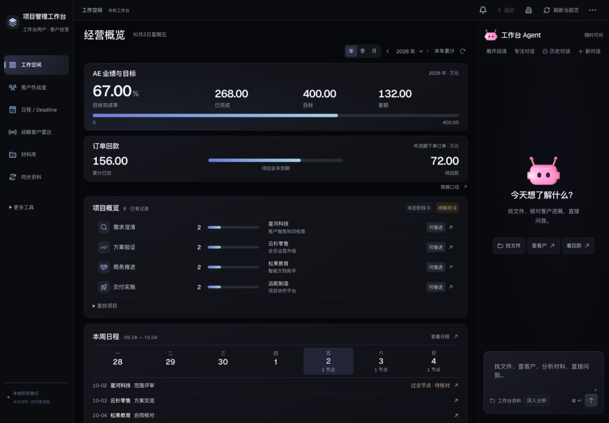

<div align="center">

# 项目管理工作台

**项目进展有全貌，判断有依据，跟进有去处。**

Project Workbench · 带 Agent 的本机项目管理工作台

[界面预览](#界面预览) · [快速体验](#快速体验) · [功能边界](#功能边界) · [宣传文案](docs/announcement.md)

</div>

把散落在文件、沟通和日程中的项目线索，组织成可追溯的项目推进视图。首页看经营数据、项目阶段和本周安排；需要深入了解时，进入客户作战室或直接询问 Agent。

本项目从真实个人工作流程中迭代而来，面向需要同时处理客户沟通、项目协调与材料归档的桌面用户。当前是公开展示版本，尚未授予额外使用许可；不是已开放商用许可的开源产品。

## 界面预览



*截图来自离线演示：客户名称、项目、金额及日程全部为虚构数据。Agent 界面展示不代表演示已接通模型。*

## 一个项目，四个连续的问题

| 要回答的问题 | 工作台如何承接 |
|---|---|
| 现在到哪一步了？ | 项目阶段、当前判断、卡点和最新来源 |
| 这个判断依据是什么？ | 关联沟通、材料原文、来源时间和待核验状态 |
| 下一步该做什么？ | 已约定节点、日程与可核对的执行记录 |
| 信息太多怎么办？ | 常驻 Agent 入口，用问题找到资料与项目上下文 |

另外提供经营概览、回款口径、材料版本及日程归档。它仍带有销售项目协作的领域特征，并不是覆盖所有行业的通用项目管理 SaaS。

## 快速体验

建议 Node.js 22.12+、Python 3.11+；本机深度集成以 macOS 为主。桌面界面优先。

```sh
git clone https://github.com/pandongxu0873-coder/project-workbench.git
cd project-workbench
npm ci
npm run build
python3 tools/demo_server.py
```

打开 **http://127.0.0.1:8878/** 查看离线演示。演示服务只提供虚构展示数据：不调用模型、不连接外部服务、不读取本机客户资料，保存/同步等写操作会明确拒绝。

## 本机完整运行

前端构建后，可以启动真实本机后端：

```sh
python3 -m venv tools/.communication-venv
tools/.communication-venv/bin/python -m pip install -r tools/communication-requirements.txt
python3 server.py --host 127.0.0.1 --port 8766
```

**若你的电脑已在 8766 运行其他工作台，请使用其他端口并同步调整开发代理。** 默认公开版使用独立本机状态目录，不加载原作者的运行环境。环境变量说明见 [.env.example](.env.example)；它只是配置示例，后端不会自动加载 .env 文件。

连接器需要自行配置资料路径、工具、登录态和授权。CRM 公司地址与飞书内部资源 ID 已移除；CRM 适配器保留接口结构，实际系统需要适配。Agent 后端保留本机模型/Codex 调用代码，需要本机对应运行工具与授权，不会因下载源码自动获得模型能力。品牌图片/PDF提取可选依赖：`Pillow`、`PyMuPDF`；只读 MCP 连接器依赖见 `tools/workbench_mcp/requirements.lock`。

## 功能边界

- **保留来源。** 采集、归档、关联和分析就绪是不同状态；失败时保留旧记录。
- **区分事实与判断。** 已做动作不等于客户确认，建议不自动变成正式待办。
- **明确项目身份。** 按客户身份与原文关联，不用相似标题猜归属。
- **日程可恢复。** 旧日程按时间归档到历史视图，归档对话不取消项目跟进。
- **连接器按授权运行。** 邮箱、日历、会议记录和微信读取是可选能力；本仓库不提供账号、凭据或他人数据。
- **本机优先。** 后端按本机访问设计，尚未经过公网托管安全加固；不要直接作为公开多租户服务部署。

## 源码结构

```text
src/                       React 界面与视图模型
server.py                  本机 HTTP 后端
project_*.py               项目分析、执行、证据与历史
material_*.py              材料归档、来源与版本
tools/                     沟通整理、只读 MCP、离线演示
wechat-local/              可选本机微信连接器
tests/                     隔离功能测试
docs/                      虚构数据展示图、宣传文案与发布说明
```

## 验证

```sh
npm test
FEISHU_REMINDER_CHAT_ID=test-fixture-chat python3 -m unittest discover -s tests -p 'test_*.py'
npm run build
```

后端测试需要上面创建的 `tools/.communication-venv`。测试使用隔离数据；测试通过不意味着所有外部系统已接通。

## 公开范围与许可

公开版本包含通用前后端源码、合成测试、空配置与演示。真实客户材料、录音、聊天、合同、历史分析、凭据、公司配置和旧 Git 历史不包含在公开仓库中。

原创项目代码暂保留全部权利，不授予额外使用许可，见 [COPYRIGHT.md](COPYRIGHT.md)。第三方组件按各自许可证分开处理，见 [THIRD_PARTY_NOTICES.md](THIRD_PARTY_NOTICES.md)。GitHub 对公开仓库的查看与平台内 fork 规则另依其平台条款。

欢迎通过 Issues 提供界面和工作流程反馈，请使用虚构例子，不上传客户原件、个人信息或凭据。

## 公开版范围

保留工作空间、项目作战室、日程、战略客户雷达、材料库与沟通同步主架构。个人版的“更多工具”整组功能不包含在当前公开版：销售捕捉、独立客户目录、独立合同业绩页、报价审批、群日报页、AI资讯和发票夹。首页经营概览、项目内客户身份与沟通证据保留。连接服务需自行配置。
